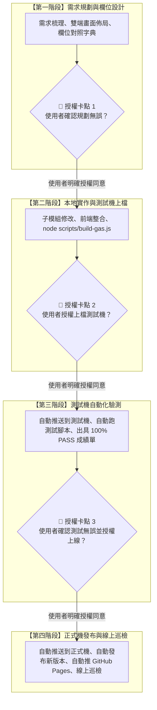

# Project LINE Order - AI 開發與升級強制執行規範 (Project Rules)

本工作區（Workspace）是基於 Google Apps Script (GAS)、Google 試算表 (Google Sheets)、LINE LIFF 與前端響應式網頁所架構的電商與代購管理系統。

為落實最高規格的軟體工程安全治理，兼顧「**使用者無需手動操作終端機（全自動化執行）**」與「**使用者百分之百掌控推進節奏（關鍵里程碑強制授權）**」，**任何在此專案進行操作的 AI 助理，必須嚴格遵守以下「三階段人工授權閘門」與標準作業規範**：

---

## 🛑 核心原則：三階段人工授權閘門 (3-Stage Authorization Gates)

**AI 嚴禁擅自跨階段前進！每一階段完成後，AI 必須主動停下、呈報成果，並等待使用者明確回覆「授權 / 同意」後，方可進入下一階段：**



---

## 📋 三階段授權與雙軌全自動作業規範

### 階段一：規劃設計與【第一授權卡點】 (Plan & Schema Approval)
1. 遇到功能開發或介面更新需求時，AI 第一步必須主動向使用者確認：
   - **升級類型**：純視覺雛形展示（Preview Only）？還是正式功能整合（Production Upgrade）？
   - **欄位增減**：定義 Google Sheets 中文表頭名稱、前端 JS Key、資料型態與預設值。
   - **雙端適配規劃**：同時規劃電腦端（1440px）與手機端（375px/390px, `100dvh`, 44px 熱區）佈局。
   - **既有資料相容性**：歷史資料是否需自動填入預設值？
2. 🛑 **【第一授權卡點】**：呈報上述規劃清單，**明確提問請示使用者授權**。
   - **未獲使用者明確授權前，嚴禁逕自修改任何正式實體程式碼！**

---

### 階段二：本地程式碼實作與【第二授權卡點】 (Implementation & Test Deploy Approval)
1. **獲取使用者授權後**，AI 開始在本地進行實作：
   - 後端模組化：至 `src/gas/modules/` 修改對應子模組（嚴禁直接動 `Code.gs`）。
   - 前端整合：合併至指定前端檔案，禁止殘留 Mock Data，附加防快取戳記。
   - 本地自動編譯：執行 `node scripts/build-gas.js`，確保 100% 通過 V8 語法檢測並產出 `Code.gs`。
2. 🛑 **【第二授權卡點】**：向使用者清楚展示本次修改的模組清單、邏輯重點與編譯結果，並提問：
   > *「本地代碼實作與打包編譯已 100% 完成，是否授權我將最新代碼推送到【測試機】並執行自動化驗測？」*
   - **未獲使用者明確授權前，嚴禁擅自推送至測試機或執行測試！**

---

### 階段三：測試機自動化驗測與【第三授權卡點】 (Test Verification & Production Release Approval)
1. **獲取使用者授權後**，AI 全自動化在背景執行測試作業（**使用者完全無需開啟終端機**）：
   - 自動切換並推送到測試機：`cp .clasp.test.json .clasp.json && clasp push -f`。
   - 自動執行驗測腳本：`node scripts/test-high-frequency-logs.js` 等驗測程式。
   - 雙端響應式與防破版自檢（手機端無橫向溢出、電腦端排版對齊）。
   - 彙整並出具**「測試機自動化驗測成績單」**（必須 100% PASS）。
2. 🛑 **【第三授權卡點】**：向使用者展示完整的測試機驗測成績單與測試成果，並提問：
   > *「測試機自動化驗測已 100% 通過，功能運作完全正常，是否授權我正式發布上線至【正式營運環境】？」*
   - **未獲使用者明確授權前，嚴禁擅自碰觸或推送到正式機！**

---

### 階段四：正式機全自動一鍵發布與巡檢 (Automated Production Release)
當使用者發出**正式上線授權**後，AI 直接在背景自動執行全套上線作業（**使用者完全無需碰觸終端機**）：
1. **自動切換並推送至【正式機】**：
   ```bash
   cp .clasp.prod.json .clasp.json && clasp push -f
   ```
2. **自動發布正式機 Web App 新版本**：
   ```bash
   clasp deploy --description "版本更新說明"
   ```
3. **自動推送前端代碼更新 GitHub Pages**：
   ```bash
   git add . && git commit -m "更新說明" && git push origin main
   ```
4. **正式環境生產線上巡檢 (Smoke Test)**：
   - 進行線上輕量驗收，確認正式環境 API 與資料庫回顯 100% 正常。
5. **回報正式上線完成**：向使用者呈報發布新版本號與線上巡檢結果。
