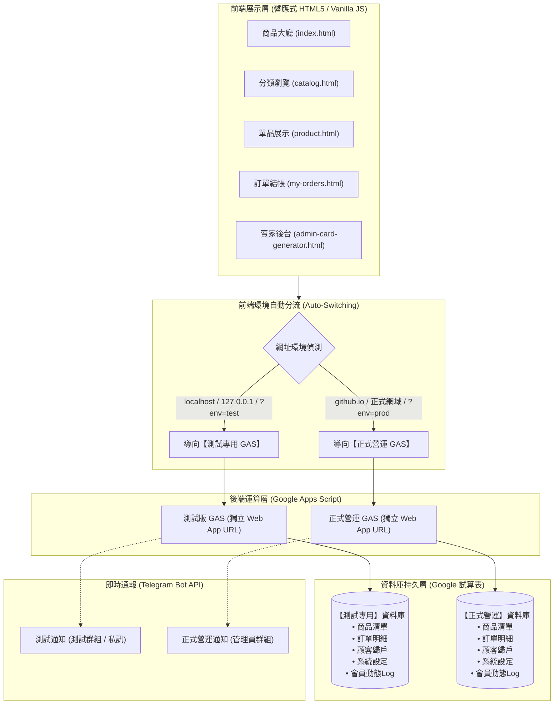
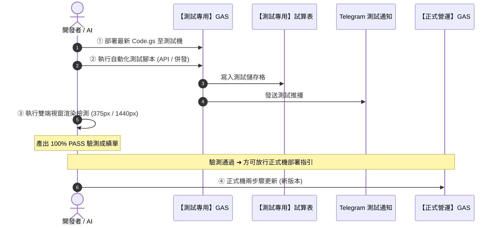

# Project LINE Order - 完整系統建置、維護升級與雙軌驗測操作手冊 (Complete Operations Manual)

> **版本**：v2.0 (雙軌隔離、模組化 GAS、自動化驗測與 Telegram 整合版)  
> **適用角色**：開發工程師、AI 協作助理、系統維運人員、電商代購管理者

---

# 📑 目錄 (Table of Contents)

- [1. 系統架構與雙軌環境定義](#1-系統架構與雙軌環境定義)
- [2. 全新系統從零建置作業流程 (Initial Setup SOP)](#2-全新系統從零建置作業流程-initial-setup-sop)
  - [步驟 1：建立 Google 試算表（測試機與正式機）](#步驟-1建立-google-試算表測試機與正式機)
  - [步驟 2：後端模組編譯與 Apps Script 初始化 (`setupSpreadsheet`)](#步驟-2後端模組編譯與-apps-script-初始化-setupspreadsheet)
  - [步驟 3：部署 Web 應用程式 (Web App)](#步驟-3部署-web-應用程式-web-app)
  - [步驟 4：設定 Telegram 即時推播機器人](#步驟-4設定-telegram-即時推播機器人)
  - [步驟 5：LINE Developers 申請與 LIFF 建立](#步驟-5line-developers-申請與-liff-建立)
  - [步驟 6：前端設定與 GitHub Pages 發布](#步驟-6前端設定與-github-pages-發布)
  - [步驟 7：端到端初始上線閉環驗收](#步驟-7端到端初始上線閉環驗收)
- [3. 功能規劃與雙端設計標準作業流程 (Planning & Design SOP)](#3-功能規劃與雙端設計標準作業流程-planning--design-sop)
  - [實作前 4 大確認閘門](#實作前-4-大確認閘門)
  - [前後端欄位對照字典 (Schema Alignment)](#前後端欄位對照字典-schema-alignment)
  - [電腦端 vs 手機 LINE 端雙佈局適配規範](#電腦端-vs-手機-line-端雙佈局適配規範)
  - [手機 LINE 內嵌「4 大防破版防卡死」標準](#手機-line-內嵌4-大防破版防卡死標準)
- [4. 日常維護開發與模組編譯作業流程 (Maintenance & Development SOP)](#4-日常維護開發與模組編譯作業流程-maintenance--development-sop)
  - [後端 7 大子模組維護職責](#後端-7-大子模組維護職責)
  - [自動編譯打包腳本 (`node scripts/build-gas.js`)](#自動編譯打包腳本-node-scriptsbuild-gasjs)
  - [前端程式碼整合與防快取標記 (Cache-Busting)](#前端程式碼整合與防快取標記-cache-busting)
- [5. 【強制閘門】測試機先行驗測流程 (Test-First Gate)](#5-強制閘門測試機先行驗測流程-test-first-gate)
  - [測試機 Apps Script 部署](#測試機-apps-script-部署)
  - [自動化測試腳本實測](#自動化測試腳本實測)
  - [雙端響應式與無報錯自檢](#雙端響應式與無報錯自檢)
  - [出具 100% PASS 驗測成績單](#出具-100-pass-驗測成績單)
- [6. 正式機部署與生產線上巡檢 (Production Release & Smoke Test)](#6-正式機部署與生產線上巡檢-production-release--smoke-test)
  - [正式營運 Apps Script 兩步驟更新](#正式營運-apps-script-兩步驟更新)
  - [前端 GitHub Pages 正式發布](#前端-github-pages-正式發布)
  - [正式環境生產線上巡檢 (Smoke Test)](#正式環境生產線上巡檢-smoke-test)
- [7. 日常維運、健康監控與故障排除 (Operations & Troubleshooting)](#7-日常維運健康監控與故障排除-operations--troubleshooting)
  - [會員動態 Log 滾動式健康修剪 (`cleanOldCustomerLogs`)](#會員動態-log-滾動式健康修剪-cleanoldcustomerlogs)
  - [常見故障排除速查表 (Troubleshooting)](#常見故障排除速查表-troubleshooting)

---

# 1. 系統架構與雙軌環境定義

本系統具備嚴格的**雙軌環境隔離（Dual-Track Isolation）**，確保測試假資料永遠不污染正式營運報表，改版測試不干擾買家下單：



---

# 2. 全新系統從零建置作業流程 (Initial Setup SOP)

### 步驟 1：建立 Google 試算表（測試機與正式機）
1. 登入 Google 雲端硬碟，建立兩個空白試算表：
   - 正式機：`連線代購資料庫`
   - 測試機：`【測試專用】連線代購資料庫`
2. 記下兩個試算表的網址與試算表 ID。

### 步驟 2：後端模組編譯與 Apps Script 初始化 (`setupSpreadsheet`)
1. 開啟本機終端機，執行自動打包腳本產出最新代碼：
   ```bash
   node scripts/build-gas.js
   ```
2. 打開試算表 ➔ 點擊選單 **「擴充功能」 ➔ 「Apps Script」**。
3. 清空 `程式碼.gs`，將本機 `src/gas/Code.gs` 完整內容全選貼入並儲存 (`Cmd + S`)。
4. **執行初始化**：
   - 工具列函式下拉選單選擇 **`setupSpreadsheet`** ➔ 點擊 **「執行」**。
   - 首次執行授權：點擊「審查權限」➔ 選擇帳號 ➔「進階」➔「前往專案（不安全）」➔「允許」。
   - 完成後試算表會自動建立：`商品清單`、`訂單明細`、`顧客歸戶`、`系統設定`、`會員動態Log`。
   - *（測試機與正式機皆需各執行一次）*。

### 步驟 3：部署 Web 應用程式 (Web App)
1. 點擊 Apps Script 右上角 **「部署」 ➔ 「新增部署作業」**。
2. 齒輪選擇 **「網路應用程式」 (Web App)**：
   - **說明**：`v1.0 初始化`
   - **執行身分**：選擇 **「我」 (Me)**
   - **誰可以存取**：務必選擇 **「所有人」 (Anyone)**
3. 點擊「部署」，複製生成的 Web App URL（以 `/exec` 結尾）。
4. 分別取得【正式 GAS URL】與【測試 GAS URL】。

### 步驟 4：設定 Telegram 即時推播機器人
1. 在 Telegram 搜尋 `@BotFather`，發送 `/newbot`，依指示取得 `Bot Token`。
2. 將機器人加入管理員群組，並透過 `https://api.telegram.org/bot<TOKEN>/getUpdates` 取得 `chat_id`。
3. 開啟試算表 `系統設定` 工作表，填入以下參數：
   - `TELEGRAM_BOT_TOKEN`：填入機器人 Token
   - `TELEGRAM_CHAT_ID`：填入群組 Chat ID
   - `TELEGRAM_NOTIFY_PAGE_VIEWS`：`TRUE`（訪客瀏覽通知，含 60 秒快取去重防灌訊）
   - `TELEGRAM_NOTIFY_ORDERS`：`TRUE`（買家下單通知）
   - `TELEGRAM_NOTIFY_PAYMENTS`：`TRUE`（匯款對帳通知）
   - `ADMIN_LINE_UIDS`：填入管理員的 LINE UID（逗號分隔），以啟動雙重門禁。

### 步驟 5：LINE Developers 申請與 LIFF 建立
1. 前往 [LINE Developers Console](https://developers.line.biz/) 登入。
2. 建立 Provider ➔ 建立 **LINE Login** Channel。
3. 切換至 **LIFF** 分頁 ➔ 點擊 **Add**：
   - **LIFF app name**：`連線下單系統`
   - **Size**：`Full`
   - **Endpoint URL**：填入前端首頁網址（如 GitHub Pages 網址 `https://<user>.github.io/<repo>/index.html`）。
   - **Scopes**：勾選 `profile`、`openid`。
   - ⭐ **關鍵核心**：將 **`Share Target Picker`** 設定為 **`Enabled (開啟)`**（賣家推播 Flex 卡片必備）。
4. 儲存後複製生成的 **LIFF ID**。

### 步驟 6：前端設定與 GitHub Pages 發布
1. 開啟前端檔案（`index.html`、`catalog.html`、`product.html`、`my-orders.html`、`admin-card-generator.html`）。
2. 在全域設定區確認填入：
   - `LIFF_ID`
   - `GAS_URL_PROD`（正式機 Web App URL）
   - `GAS_URL_TEST`（測試機 Web App URL）
3. 將代碼提交並推送到 GitHub 的 `main` 分支。
4. 在 GitHub 儲存庫進入 **Settings ➔ Pages** ➔ 選擇 `Deploy from a branch` (main / root) ➔ 儲存上線。

### 步驟 7：端到端初始上線閉環驗收
1. **後台建檔**：開啟 `admin-card-generator.html`，新增商品並上傳多圖，確認寫入試算表。
2. **群組推播**：用手機開啟後台，勾選商品，點擊「一鍵打包推播至 LINE 群組」，確認 Flex 卡片送出。
3. **前台搶購**：點擊卡片下單，確認試算表寫入且 Telegram 秒級收到推播。
4. **合併結帳**：開啟 `my-orders.html` 進行結帳，確認運費與金額正確計算。

---

# 3. 功能規劃與雙端設計標準作業流程 (Planning & Design SOP)

為避免「介面更新頻繁，卻未與後端實質整合」或「電腦版看起來正常、手機版面卡住崩潰」，任何新功能在進入程式碼實作前，必須執行以下規劃作業：

### 實作前 4 大確認閘門
在動工前必須主動確認：
1. **升級類型確認**：純視覺雛形展示（Preview Only）？還是正式功能上線整合（Production Upgrade）？
2. **資料欄位確認**：有無新增、刪除或修改 Google Sheets 欄位？
3. **目標實體檔案**：明確落實在哪一個正式檔案（例如 `product.html`、`my-orders.html` 等）。
4. **既有資料相容性**：歷史資料是否需自動填入預設值？是否需修復腳本？

### 前後端欄位對照字典 (Schema Alignment)
凡涉及欄位異動，必須在規格中定義清楚：
| 試算表中文表頭 | 前端 JS Key | 資料格式 | 預設值 | 說明 |
| :--- | :--- | :--- | :--- | :--- |
| `供應模式` | `supplyMode` | 字串 | `連線` | 可選：`現貨` / `預購` / `連線` |
| `最低可見等級` | `minTier` | 字串 | `一般會員` | 可選：`一般會員` / `VIP會員` |
| `商品重量(g)` | `weight` | 數字 | `0` | 空運成本計算用 |

### 電腦端 vs 手機 LINE 端雙佈局適配規範
規劃時必須同時產出雙端佈局對照：
- 💻 **電腦端 (Desktop, $\ge 768\text{px}$)**：寬螢幕 3~4 欄 Grid、居中對齊浮動彈窗 (Modal)、顯示完整公式明細。
- 📱 **手機 LINE 端 (Mobile, $< 768\text{px}$)**：單欄垂直卡片流、**底部滑出抽屜 (Bottom Sheet)**、資訊折疊收納。

### 手機 LINE 內嵌「4 大防破版防卡死」標準
1. **動態高度適配**：全面採用 `min-height: 100dvh;`（嚴禁使用靜態 `100vh` 導致被導航條遮擋）。
2. **零橫向溢出**：外層容器強制 `overflow-x: hidden; width: 100%;`，長文字強制 `overflow-wrap: anywhere;`。
3. **底部安全邊界 (Safe Area)**：吸底按鈕必須加入 `padding-bottom: calc(12px + env(safe-area-inset-bottom));`。
4. **44px 觸控熱區**：所有按鈕、勾選框與輸入元件尺寸皆不得小於 `44px × 44px`。

---

# 4. 日常維護開發與模組編譯作業流程 (Maintenance & Development SOP)

### 後端 7 大子模組維護職責
> ⚠️ **嚴禁直接手動編輯單一龐大的 `src/gas/Code.gs`！**
必須至 `src/gas/modules/` 修改對應子模組：
- `00_Config.gs`：系統常數、白名單與共用工具工具。
- `01_Router.gs`：Web App API 路由分發 (`doGet` / `doPost`)。
- `02_ProductService.gs`：商品管理（CRUD、多圖、原幣空運成本計算）。
- `03_OrderService.gs`：搶購保留、加單合併、結帳出貨、採購作業站。
- `04_CustomerService.gs`：顧客歸戶、會員動態 Log、1對1結帳通報名單。
- `05_TelegramService.gs`：Telegram 推播排版、訪客稱呼比對。
- `06_SystemAdminService.gs`：試算表結構初始化 (`setupSpreadsheet`)、無損擴充欄位、健康排程。

### 自動編譯打包腳本 (`node scripts/build-gas.js`)
每次修改後端子模組後，必須在終端機執行：
```bash
node scripts/build-gas.js
```
- **自動化保障**：腳本會依序載入 7 大子模組，並進行 V8 / Node.js 語法檢驗，100% 確保零語法錯誤才輸出 `src/gas/Code.gs`。

### 前端程式碼整合與防快取標記 (Cache-Busting)
1. **正式 API 串接**：禁止在正式檔案留存寫死的 `mockData`，必須接上 `fetch(GAS_API_URL)`。
2. **防快取版本戳記**：手機 LINE 快取極強，任何前端更動必須同步更新版本號（例如 `v=20261121_v1`），並附加在跨頁跳轉與靜態資源網址後方。

---

# 5. 【強制閘門】測試機先行驗測流程 (Test-First Gate)

> 🛑 **鐵律：嚴禁在未經測試機驗測前直接部署至正式機！**



### 測試機 Apps Script 部署
1. 開啟本機編譯完成的 `src/gas/Code.gs` 全選複製。
2. 前往【測試專用 Apps Script 編輯器】，貼上覆蓋並儲存。
3. 部署管理中更新為「新版本」。

### 自動化測試腳本實測
在終端機執行驗測腳本（例如針對高頻寫入、防刷屏與 API 結構測試）：
```bash
node scripts/test-high-frequency-logs.js
```
- 自動測試資料寫入測試試算表儲存格是否正確。
- 測試高頻並發情境（防刷屏去重、交易鎖保護）。
- 測試 Telegram 機器人推播排版是否正常送達。

### 雙端響應式與無報錯自檢
- 📱 **手機端 (375px / 390px)**：檢測 `scrollWidth === clientWidth`，確保無水平破版、按鈕不被遮蔽。
- 💻 **電腦端 (1440px)**：檢測多欄格線佈局與彈窗對齊正常。

### 出具 100% PASS 驗測成績單
AI / 開發者必須在交付時出具成績單，所有項目為 PASS 方可進行下一步：
| 檢測階段 | 檢測項目 | 目標環境 / 指標 | 實測結果 | 狀態 |
| :--- | :--- | :--- | :--- | :---: |
| 語法編譯 | 後端自動打包 | `build-gas.js` | 7 個模組語法正確 | ✅ PASS |
| API 實測 | 訂單寫入 / 欄位更新 | 測試專用 GAS | 回應 580ms，回傳 success | ✅ PASS |
| 資料庫 | 試算表欄位動態擴充 | 測試試算表 | 動態表頭 indexOf 成功定位 | ✅ PASS |
| Telegram | 營運即時推播 | 測試 Bot / Chat ID | 測試訊息秒級送達排版正確 | ✅ PASS |
| 雙端響應 | 手機與電腦螢幕適配 | 375px / 1440px | 無橫向溢出、100dvh 生效 | ✅ PASS |

---

# 6. 正式機部署與生產線上巡檢 (Production Release & Smoke Test)

當測試機自動化驗測 100% PASS 後，執行正式發布：

### 正式營運 Apps Script 兩步驟更新
1. **複製程式碼**：全選複製本機 `src/gas/Code.gs` ➔ 前往【正式營運 Apps Script 編輯器】貼上覆蓋並儲存 (`Cmd + S`)。
2. **發布新版本**：
   - 點擊右上角 **「部署」 ➔ 「管理部署作業」**。
   - 點擊右側 ✏️ **鉛筆圖示（編輯）**。
   - 在「版本」下拉選單中，務必選擇 **「新版本」 (New version)**。
   - 點擊右下角 **「部署」** 完成發布！

### 前端 GitHub Pages 正式發布
1. 確保跨頁跳轉與資源皆已帶上最新版本戳記（如 `?v=20261121_v1`）。
2. 將前端變更推送至 GitHub `main` 分支。
3. GitHub Pages 自動完成正式機部署。

### 正式環境生產線上巡檢 (Smoke Test)
上線後進行 1 分鐘極速線上健康檢查：
1. 開啟正式環境線上首頁，確認頁面載入順暢，Console 零報錯。
2. 進行一次輕量瀏覽點擊，確認正式試算表與 Telegram 正式通報群組正常運作。

---

# 7. 日常維運、健康監控與故障排除 (Operations & Troubleshooting)

### 會員動態 Log 滾動式健康修剪 (`cleanOldCustomerLogs`)
- **機制說明**：系統在 `04_CustomerService.gs` 與 `06_SystemAdminService.gs` 中內建滾動式修剪機制，自動保留最新的 5,000 列日誌，將超過的舊紀錄自動修剪。
- **排程設定**：可在正式營運 Apps Script 的「觸發條件」中，新增一個「時間驅動」的定時觸發器：
  - 執行函式：`cleanOldCustomerLogs`
  - 活動來源：時間驅動 ➔ 每日計時器 ➔ 每天凌晨 04:00~05:00 執行。
- **效益**：確保 Google 試算表永遠維持輕量飛快，長期營運絕不卡頓崩潰。

### 常見故障排除速查表 (Troubleshooting)

| 異常現象 | 常見成因 | 排除方式 |
| :--- | :--- | :--- |
| **前端呼叫 API 報 403 Forbidden** | GAS 部署權限設定錯誤 | 前往 GAS 管理部署作業，將「誰可以存取」重新設定為 **「所有人」 (Anyone)** 並儲存為新版本。 |
| **修改了 GAS 邏輯，但線上完全沒反應** | GAS 部署未選擇「新版本」 | GAS 必須在「管理部署作業」點鉛筆編輯，在版本選單選擇 **「新版本」** 後按部署，伺服器才會載入最新代碼。 |
| **手機 LINE 打開一直是舊畫面** | LINE 內嵌瀏覽器快取極強 | 在跳轉網址後方附加防快取參數（如 `?v=20261121_v2`），或手動在 LINE 中傳送帶有新參數的網址點開。 |
| **手機版畫面出現左右橫向滑動破版** | 某元件寬度寫死或長字串未斷行 | 容器加上 `overflow-x: hidden;`，字串加上 `overflow-wrap: anywhere;`，表格套用可捲動容器。 |
| **手機底部按鈕被 LINE 導航列擋住** | 使用了靜態 `100vh` 或未設 Safe Area | 改用 `100dvh`，並在底部加入 `padding-bottom: calc(12px + env(safe-area-inset-bottom));`。 |
| **LIFF 登入跳出 Invalid redirect_uri** | LINE Developers Endpoint 不匹配 | 登入 LINE Developers 後台，檢查 LIFF Endpoint URL 是否與實際前端網址完全一致（含 https 與檔名）。 |
