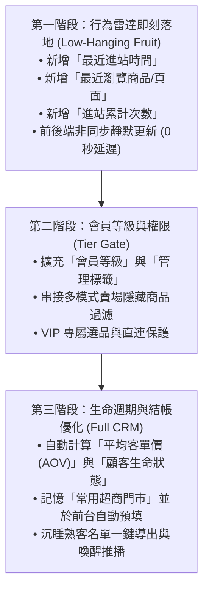

# 顧客歸戶與會員行為數據分析規劃書 (CRM & Behavior Radar)

> **建立日期**：2026/10/22  
> **規劃定位**：將現有試算表「顧客歸戶」從被動的下單記錄簿，全面升級為具備**「顧客生命週期分析 (CRM)」**與**「即時逛店意圖雷達 (Behavior Tracking)」**的決策中心，協助賣家掌握客人的即時動向、消費實力與購買意向，進行高精準度的社群導購與喚醒。

---

## 📌 一、 顧客全方位畫像四大維度架構

```
【顧客歸戶完整數據畫像】
├── 1. 訪客活躍與逛店雷達（客人現在想買什麼？即時意圖）
│   ├── 最近進站時間 (Last Visit Time)
│   ├── 最近瀏覽頁面/商品 (Last Viewed Product/Page)
│   └── 進站累計次數 (Total PV / Engagement Level)
│
├── 2. 會員等級與私密權限（分級維護與專屬選品）
│   ├── 會員等級 (Member Tier: 一般會員 / VIP / VVIP / 批發夥伴)
│   └── 顧客特性標籤 (Customer Tags: 如「專櫃保養控」、「球鞋買手」、「免運促購」)
│
├── 3. 消費實力與履約習慣（降低出貨風險、提高客單價）
│   ├── 平均客單價 AOV (總消費金額 ÷ 歷史訂單數)
│   ├── 偏好付款方式 (LINE Pay / 銀行匯款 / 超商貨到付款)
│   └── 常用取件超商門市 (7-11 或全家店號與門市名稱，結帳自動預填)
│
└── 4. 顧客生命週期與健康度警示（防止客源流失）
    ├── 顧客生命狀態 (🟢熱烈活躍 / 🟡潛在猶豫 / 💤沉睡熟客 / 🚨流失警報)
    ├── 下單轉換率 (歷史訂單數 ÷ 總進站次數)
    └── 黑名單/履約風險標記 (跑單、棄單或未取貨紀錄防呆)
```

---

## 📌 二、 完整欄位藍圖規格 (藍圖：共 17 欄)

未來【顧客歸戶】工作表欄位升級標準規劃如下：

| 欄位序 | 欄位名稱 | 資料型態 | 產生方式 | 核心效益與管理說明 |
| :---: | :--- | :---: | :---: | :--- |
| **A** | `LINE_User_ID` | 文字 | 系統自動 | 唯一身分辨識碼 (UID)，用於跨頁面身分識別與資料連動。 |
| **B** | `最新暱稱` | 文字 | 系統自動 | 顧客當前在 LINE 上設定的暱稱 (支援動態更新)。 |
| **C** | `真實姓名` | 文字 | 顧客填寫 | 結帳/下單時所填寫之收件人真實中文姓名。 |
| **D** | `電話` | 文字 (`@`) | 顧客填寫 | 統一格式之手機號碼 (確保純文字防止開頭 `0` 被試算表截斷)。 |
| **E** | `會員等級` | 下拉選單 | 系統/手動 | `一般會員` / `VIP` / `VVIP` / `批發夥伴` (與 Tier Gate 連動)。 |
| **F** | `顧客生命狀態` | 計算/標籤 | 系統自動 | 依最後下單與進站天數自動計算：🟢活躍 / 🟡猶豫 / 💤沉睡 / 🚨流失。 |
| **G** | `歷史訂單數` | 數值 | 系統自動 | 該會員在賣場成功建立之訂單總筆數。 |
| **H** | `總消費金額` | 貨幣 | 系統自動 | 該會員歷來累計之有效消費總金額 (NT$)。 |
| **I** | `平均客單價 (AOV)` | 貨幣 | 系統自動 | `=IF(G2>0, ROUND(H2/G2), 0)`，衡量顧客購買實力與含金量。 |
| **J** | `首購日期` | 日期 | 系統自動 | 該會員第一次下單的時間，標誌顧客與賣場關係的起點。 |
| **K** | `最後下單日期` | 日期時間 | 系統自動 | 最近一次實際出資購買的日期時間。 |
| **L** | **`最近進站時間`** | 日期時間 | 系統自動 | **顧客最近一次打開商城/點開商品卡片的精確時刻。** |
| **M** | **`最近瀏覽商品/頁面`** | 文字 | 系統自動 | **最後一次瀏覽的商品名稱或頁面路徑 (掌握即時購物興趣)。** |
| **N** | **`進站累計次數`** | 數值 | 系統自動 | 累計瀏覽頁面總次數，衡量該客戶的參與度與猶豫程度。 |
| **O** | `常用取件門市` | 文字 | 系統自動 | 最近一次結帳所選擇的超商門市代碼與名稱 (可於結帳時智慧帶入)。 |
| **P** | `黑名單標記` | 選項 | 管理者手動 | `正常` / `棄單觀察` / `黑名單拒絕往來`。 |
| **Q** | `管理備註/特性標籤` | 文字 | 管理者手動 | 自由填寫客戶偏好 (如「Aesop愛用者」、「大尺碼優先」、「只在免運時買」)。 |

---

## 📌 三、 商業應用與實際操作情境 (SOP)

### 1. 抓緊當下意向：精準社群聊聊（轉換率最高）
- **情境**：在後台看到顧客「最近進站時間是 10 分鐘前」，正在看「【商品】韓國🌿VT PDRN精華」，但他「最後下單日期是 3 個月前」。
- **行動**：管理者直接在 LINE 私訊他：「嗨 Penny，好久不見！剛好看到這次韓國連線有妳喜歡的保養品，這罐 PDRN 精華現貨只剩 2 瓶，有需要先幫妳保留一瓶一起寄嗎？」
- **效果**：省去無效寒暄，在顧客最具購買慾望的黃金時刻直接切入痛點成交。

### 2. 喚醒沉睡顧客：分群行銷（防止客源流失）
- **情境**：試算表篩選「`顧客生命狀態` = 💤沉睡熟客」（超過 60 天未曾進站與下單）。
- **行動**：由管理者於 LINE 官方帳號群發或私訊「老友回娘家限定 50 元折價券」，並附上本次檔期的熱銷爆款。
- **效果**：主動啟動沉睡客群，降低顧客流失率。

### 3. VIP 尊榮分級維護（Tier Gate 機制串接）
- **情境**：顧客累計消費金額達到 NT$ 10,000，系統或管理者將其等級調整為 `VIP`。
- **行動**：前台商城解鎖專櫃限量款與 VIP 專屬優惠價；在發送 LINE 推播卡片時，自動打上「VIP 尊榮特選」標籤。
- **效果**：強化核心客群的尊榮感與黏著度，保護私密或高敏感代購貨源。

### 4. 履約防呆與結帳流程加速
- **情境**：回國開放統一結帳通道時，結帳頁面自動載入顧客的 `真實姓名`、`電話` 與 `常用取件門市`。
- **效果**：老客人 10 秒內快速完成結帳確認，不再因重複打字煩瑣而放棄訂單；同時，若為「黑名單標記」客戶，系統可限制其使用貨到付款。

---

## 📌 四、 分階段實施路線圖 (Roadmap)



- **第一階段（即刻可實施）**：
  在 [src/gas/Code.gs](file:///Users/wen/projects/Project%20LINE%20Order/src/gas/Code.gs) 的 `handleRecordPageView` 觸擊處理中，當檢測到已授權之 LINE 好友進站時，同步寫入【顧客歸戶】工作表的「最近進站時間」、「最近瀏覽商品」與「累計進站次數」，完全不影響前台速度。
- **第二階段（結合賣場模式）**：
  依據 [待辦事項_多模式賣場與會員等級權限規劃.md](file:///Users/wen/projects/Project%20LINE%20Order/%E5%BE%85%E8%BE%A6%E4%BA%8B%E9%A0%85_%E5%A4%9A%E6%A8%A1%E5%BC%8F%E8%B3%A3%E5%A0%B4%E8%88%87%E6%9C%83%E5%93%A1%E7%AD%89%E7%B4%9A%E6%AC%8A%E9%99%90%E8%A6%8F%E5%8A%83.md) 中的規劃，串接等級權限檢查。
- **第三階段（全面自動化經營）**：
  建立試算表自動化狀態判斷，提供結帳常用門市預填機制。
